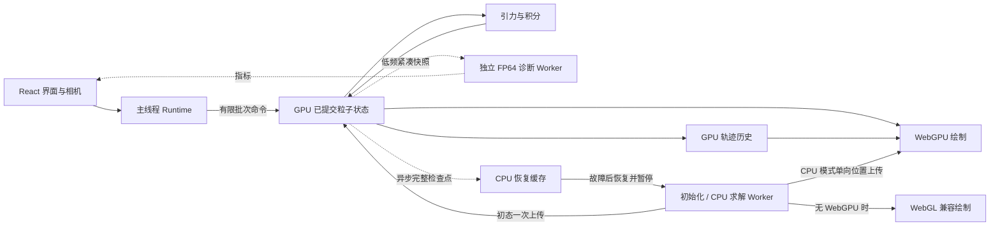

# Gravity Lab 架构重设计

日期：2026-10-13。状态：已实施；静态审查、WGSL 离线编译与生产构建已完成，独立性能计时单列记录。没有运行自动测试或产品页面验收。

目标：借鉴 Galacto 的 GPU 数据流，保留现有实验功能；完全移除八叉树引力及已失去产品用途的兼容层。用户已确认默认优先 WebGPU，不可用时回退 CPU，并保留手动选择 CPU 直接求和；碰撞与无碰撞模式都采用固定 1/60 秒积分步长。

实施说明：以下保留设计契约及其依据。新入口为 `src/runtime/create-runtime.js`，GPU 引擎位于 `src/gpu/`，绘制位于 `src/render/`。128/256 tile 当前按设备能力选择，尚未进行设备自动调优。GPU CCD 采用扫掠包围过滤、双槽有界候选与事件后参与者更新；尚无空间网格，初次候选生成仍遍历全部球对。诊断基线从实际初态异步建立，后续仅在误差页可见时计算完整指标。

## 1. 核心决策

1. 计算和绘制使用同一个 `GPUDevice / GPUQueue`，粒子状态常驻 GPU，渲染直接读取已提交状态。
2. 无碰撞与连续硬球碰撞使用独立引擎，CPU/GPU 两种模式统一固定 1/60 秒积分主步。碰撞仍按步内实际接触时刻顺序处理，不自动缩小积分步长。
3. 保留 CPU Float64 直接求和，承担兼容运行、独立数值参考和故障恢复；GPU 引擎不再维护一个逐帧同步的 CPU `Simulation` 副本。
4. 每帧绘制和每批推进均不等待粒子读回。诊断、检查点、轻量统计通过独立、有界的异步通道取得数据。
5. 继续使用现有 JavaScript/TypeScript、WGSL 和 Vite；这次不增加 Rust/WASM 工具链。相机数学与 OrbitControls 可继续复用 Three.js。
6. UI 统一管理草稿、已应用参数、实时设置与观察数据，替换隐藏 DOM 和 React 双向同步壳。

## 2. 对齐 Galacto 的哪些部分

参考固定版本 [Galacto 1223cae](https://github.com/tre-systems/galacto/tree/1223cae820ce9f0daf4f47e6a15c87540661870b)，避免上游更新使比较失去依据。

| 已核对的实现 | 本项目采用的设计 |
| --- | --- |
| 模拟缓冲直接绑定绘制管线；统计另行异步读回 | 计算与绘制共享 GPU 数据，诊断独立订阅 |
| 共享内存分块全对引力，256 线程 tile | 直接求和保留；准备 128/256 线程变体，按设备能力及计时选择 |
| 固定 1/60 秒、三个阶段的 DKD Leapfrog | 保留本项目已有 KDK 和完整步提交，合并为三个 dispatch |
| 粒子数量按 256 对齐 | 本项目保留任意整数 2–20,000，补齐执行线程而不补实体粒子 |

依据：[模拟与渲染资源](https://github.com/tre-systems/galacto/blob/1223cae820ce9f0daf4f47e6a15c87540661870b/src/simulation.rs)、[积分与求力 shader](https://github.com/tre-systems/galacto/blob/1223cae820ce9f0daf4f47e6a15c87540661870b/src/shaders/update.wgsl)。Galacto 的核心值得借鉴之处是 GPU 数据所有权和调度；语言迁移本身不能消除同步往返。

其星系场景中的质量归一化、暗物质势场与气体阻尼不移入本项目；本项目仍是现有的等质量、无边界实验。也不因为对齐其管线而取消硬球碰撞、数值保护或补偿求和。

## 3. 重构前瓶颈与对应改法

| 重构前结构 | 影响 | 新设计 |
| --- | --- | --- |
| GPU Worker → 全状态读回 → CPU 数组 → 主线程 → Three.js 上传 | 画面依赖往返与串行等待 | WebGPU 渲染直接读状态缓冲 |
| 每批 `await mapAsync` 后才继续推进 | GPU 批次之间引入 CPU 等待依赖 | 有界异步提交，完成回调只用于背压和进度 |
| 无碰撞每步仍经过 7 次 dispatch 和通用 CCD 调度 | 简单自由运动承担通用框架成本 | 独立的三个阶段 KDK |
| 每步将试算逐粒子复制成已提交状态 | 多一次全粒子读写 | 双槽状态，仅提交活动槽编号 |
| 画面快照、恢复快照、CPU 精确势能捆绑执行 | 误差面板关闭时仍有 O(N²) CPU 计算 | 按用途分别订阅、限流 |
| CPU 为全部轨迹重建线段并反复上传 | 20k 粒子时有大量内存写入和传输 | GPU 环形历史，shader 直接索引线段 |
| GPU 碰撞保存全部球对索引和接触时间 | 20k 有 199,990,000 对，索引约 1.60 GB | 有容量预算的候选集、分块兜底、CPU 回退 |

当前单粒子 GPU Body 为 128 B，20k 一份状态为 2.56 MB；若按目标 30 Hz 读取，原始状态传输量约 76.8 MB/s，另有解码与重新上传。此处是容量/频率计算，不是实测带宽；同步依赖往往比字节量更值得优先消除。当前无碰撞已不分配完整球对数组，不能把它误列为该模式现存的显存开销。

依据是重构前的 `physics/webgpu-simulation.js`、`simulation.worker.js`、`renderer.js`，这三个旧模块现已删除。这些判断来自原代码结构；新版本计时见 [PERFORMANCE.md](./PERFORMANCE.md)，不能将容量计算当作确定提速倍数。

## 4. 保留的功能与本项目优势

相对所核对的 Galacto 计算核心，本项目的长处主要是实验可控性、连续接触模型与数值可观察性。

| 必须保留 | 契约 |
| --- | --- |
| 连续硬球碰撞 | 球体 TOI、按时间处理、同刻事件固定顺序、无摩擦、恢复系数 e、事件计数；失败试算回滚 |
| CPU Float64 基准 | 手动 CPU 后端、GPU 求力与独立直接求和参考的 RMS 对照 |
| 能量和动量观察 | 精确全对势能定义；能量漂移补偿真实碰撞耗散，不将 e<1 的耗散误报为积分误差 |
| 可复现初始化 | 五种分布、准确粒子数量、种子控制位置和速度；初态无重叠 |
| G 与初始运动独立 | 速度标定固定参考 G=1；实际 G=0 也可以有初速度 |
| 时间含义清楚 | 两种模式都固定 1/60 秒；显示实际倍速，性能不足时不改变物理步长 |
| 观察交互 | 全粒子轨迹、稳定镜头、聚焦全部、清晰度、参数/误差 Tab、响应式面板 |
| 故障处理 | 只发布完整步；GPU 故障恢复最近完整检查点并暂停，用户点击继续后使用 CPU |

功能范围以当前界面为准。以下细节纳入重构契约：

- 初始面板：种子在最上方常驻，只读小字号数字和刷新图标；分布依次为均匀球云、均匀球壳、均匀圆盘、对称球壳、对称圆环，默认对称球壳。
- 数量 2–20,000，默认 384；紧密度 0.005–0.06、步进 0.005、默认 0.025；初始运动强度 Q 为 0–2、步进 0.05、默认 0；G 为 0–10、步进 0.1、默认 1；种子初始为 42。
- 物理与渲染半径固定 0.1、单粒子质量固定 1，两者独立定义；模型不再使用材料密度常量推导质量，增加数量仍增加总质量。球云范围继续使用独立参考半径 0.45。整体旋转参数继续移除；保留当前速度去平动及去除绕 Y 轴相干转动分量的初始化算法，不能将删参数变成换速度分布。该投影不等于消除所有轴的角动量。
- 碰撞控件在初始面板底部，默认关闭；开启显示 e（0–1，步进 0.01，默认 1），关闭显示 ε（0.1–5R，步进 0.1R，默认 1R=0.1，实际范围 0.01–0.5）及现有说明。
- 上述初始参数和计算后端全部点击“应用”才生效。控件切换可即时改变草稿显示，但不能即时改变正在运行的模型。
- “重新开始”使用已应用参数，忽略草稿，保留实时倍速和显示设置。首次加载自动聚焦，后续应用/重启保留相机。
- 时间倍速 0.1–20 实时生效；两种模式均显示固定 1/60 秒，移除原碰撞模式的时间精度下拉选择。模式切换、单步、CPU 回退和重启都不能改变固定积分步长。
- 暂停、继续、空格快捷键、暂停时单步、页面隐藏时暂停并清空积压均保留；暂停时相机仍可操作。
- 暖白发光粒子、全部粒子最近 64 点轨迹、自动/清晰/节能、拖动与折叠面板、模型说明、独立页及主站 iframe 集成均保留。
- 空间无边界、无周期回绕、无额外阻尼、无合并；离开初始范围的粒子不删除。碰撞关闭时完全不产生接触或分离事件。

除删除八叉树外，用户已确认的行为变化是默认 WebGPU 优先，以及碰撞也改为固定 1/60 秒并移除可调时间精度。熵此前只讨论过设计，尚无实现，不列为本轮恢复或扩展功能。

## 5. 数据所有权和线程



主线程持有唯一 GPU device、queue、canvas context，负责轻量命令编码、UI 和相机。初始化及 CPU 求解在一个 Worker，昂贵的参考诊断在另一个 Worker，避免诊断阻挡 CPU 兼容后端。

GPU 运行时的权威状态只在 GPU。CPU 保留配置、初态、少量指标和最近恢复检查点，不保留必须逐帧一致的物理镜像。CPU 模式的权威状态才由 CPU Worker 持有。

本次不采用 OffscreenCanvas，以减少输入代理和生命周期分支。若未来主线程编码被计时证明是瓶颈，再把计算与绘制整体迁到同一 Worker；不能拆成两个上下文再靠粒子快照传递。GPU buffer 也不通过 `postMessage` 跨线程共享。

引擎交给渲染器的接口是有类型区分的 `RenderSource`：

- GPU：状态缓冲绑定、活动槽控制、数量、坐标原点、epoch；不含 CPU 位置数组。
- CPU：带 epoch/step 的可转移位置数组及边界；渲染适配器负责单向上传。

优先使用 WebGPU 渲染；手动 CPU 求解也可以向其上传位置。设备不可用或丢失时启用独立、延迟加载的 WebGL 适配器。切换不同 canvas context 时创建替代 canvas，保留同一份相机状态和控件语义。

## 6. 无碰撞 GPU 引擎

物理方程保持 Plummer 引力：

\[
\mathbf a_i=Gm\sum_{j\ne i}\frac{\mathbf x_j-\mathbf x_i}{(|\mathbf x_j-\mathbf x_i|^2+\varepsilon^2)^{3/2}},\qquad \Delta t=1/60.
\]

每步采用三个独立 dispatch 提供全局阶段边界：

1. **kick_drift**：从已提交槽 A 读取 x、v、a；完成半次 kick 和一次 drift，写试算槽 B 的位置及半步速度。
2. **force_final_kick**：共享内存分块读取 B 的固定位置；每线程求自己的新加速度，并完成最终半次 kick；检查结果，发现异常设置 invalid。
3. **commit**：一个调度线程检查状态。成功仅交换 `activeIndex` 并更新完整步计数；失败保持 A、设置暂停原因。渲染和下一步始终读取活动槽。

不再有逐粒子的 publish 复制，也没有 CCD 的选事件、试探步长、碰撞重试和间接调度字段。初始化单独求一次初始加速度；G=0 使用不执行 N² 求力的管线分支，初速度仍按参考 G=1 生成。

状态按字段拆开，每个字段包含两个槽：`positionHi[2N]`、`positionLo[2N]`、`velocity[2N]`、`acceleration[2N]`。保留补偿求和、位置余量和相对原点表示。新内部表示统一约定为 `origin + hi + lo`；导入旧检查点时转换其 `hi − error` 符号约定。

四个字段均按 vec4 存储时仍为 **128 B/粒子、20k 为 2.56 MB**，不是状态显存缩小四倍。收益来自按需读取字段、合并阶段、取消状态复制和正常渲染的往返。质量、半径、G、ε 为该场景统一常量，无须逐粒子重复。

实现约束：

- 尾部不足一个 workgroup 的线程仍经过所有屏障，源粒子越界位置补零、质量置零，目标越界线程不写结果。保留精确粒子数。
- invalid 为单调故障标记，只在安全的初始化/重置边界清零。不能由任一粒子线程在并行阶段开头清零，也不能因可变的跨线程标记在屏障前分歧退出。
- 求力期间 B 的位置只读，速度/加速度分字段写入，避免读到别的线程正在修改的位置。
- 非有限数、空间分辨率、计数范围等保护保留；结合位置低位正确判断有效分辨率。无碰撞模式遇到不安全状态应暂停，不偷偷缩步或扩大 ε。
- Kahan 补偿和位置余量都不是 Float64；它们的额外代价会保留在性能比较里。256 tile 是否更快需计时，不能仅按 tile 大小推算倍数。

## 7. 碰撞引擎独立化

保持牛顿引力 ε=0，以及 KDK 匀速 drift 内的连续球体接触。TOI 精确性针对该 drift，不等于对连续变化的引力轨迹求解析碰撞。e、切向速度保留、耗散计账、同刻事件排序和失败回滚均沿用现有语义。

积分主步固定为 1/60 秒：半次引力 kick → 在整段 drift 内处理所有接触事件 → 求新引力并完成半次 kick → 完整提交。例如同一步在第 4 ms 和第 9 ms 碰撞，依次推进到这两个时刻、施加冲量，再完成至 16.67 ms；这些事件分段不重新求引力，也不是缩小 KDK 积分步。成功时位置、速度、模拟时间、碰撞数和耗散一起提交，单步按钮只推进一个完整的 1/60 秒。

删除按最大速度、最大加速度和预测接触缩小积分步的准则，以及 contactDt 和失败后折半重试。强引力近距离运动的积分误差可能比原自适应模式更大，这是固定步设计的精度取舍，继续用能量及求力诊断观察，不通过隐式缩步或放大软化长度补偿。

一个主步可以跨多个调度批次完成，事件处理位置和队列保存在试算状态中；软时间预算耗尽只让出执行权，下批继续处理同一主步，不重做已完成工作。不可恢复的数值/接触错误或硬事件上限触发时，位置、速度、加速度、时间、碰撞数与耗散全部回滚到上一已提交状态并暂停，不提交部分时间、不跳过事件、不自动改小步长。

CPU Float64 CCD 保留现有扫掠候选筛选、事件堆、参与者事件重算。GPU CCD 可以有自己的试算、接触容差和预算状态，不能让它们出现在无碰撞引擎热循环里。

最终 GPU 碰撞存储不再预分配全部 N(N−1)/2 对：

1. 在一次 drift 开始时，以保守扫掠包围范围生成候选；长扫掠或极端占用触发分块扫描，避免空间网格本身失控。
2. 对候选计算 TOI，以稳定球对 ID 打破同刻并列；全局归约选择最早事件并顺序施加冲量。
3. 事件后使涉及两个参与者的旧预测失效，并与全部其他粒子重新检查、补入新接触。其他球对的绝对接触时间仍可复用。不能只查询初始邻居而漏掉反弹后的接触。
4. 候选和事件存储有按设备能力确定的字节预算、容量检查、版本标记和回收策略。最坏候选数仍可能 O(N²)，不宣称网格必然线性。
5. 溢出时拒绝并回滚该试算，以相同的 1/60 秒主步改用分块球对扫描并归约最早事件，或从完整边界切换 CPU；仍无法完成则暂停并说明原因。禁止截断候选、跳过事件或缩小积分步长。

分块全对扫描是有界显存的正确性兜底，密集碰撞下会慢；最终仍保留按能力回退 CPU，并显示实际后端及原因。不能以并行 PBD 或离散穿透修正替换此模型后声称功能无变化。

迁移期间先将旧 GPU CCD 隔离、按实际 buffer/dispatch 限制启用，大场景使用 CPU。最终清理完成前，替换全对常驻数组和主机粒子状态依赖；不把旧实现无限期留在无碰撞核心。20k 无碰撞性能与 20k 密集碰撞性能分开评估。

任何迁移阶段对外启用的 CPU/GPU 碰撞路径都须遵守固定主步；隔离旧 CCD 时只复用事件处理算法，不沿用其自适应积分调度。

## 8. 绘制、轨迹与相机

WebGPU 顶点 shader 直接读活动位置高低位，生成实例化发光 billboard，保留现有尺寸、暖白颜色和相机距离缩放。相机相对坐标在最终投影前组合，避免过早丢掉位置低位。GPU 求解路径不再创建每帧 Three.js 位置 BufferAttribute。

轨迹为 GPU 上长度 64 的环形位置历史，延续至少 75 ms 一次的墙钟采样间隔；只采样有进展的完整状态。顶点 shader 根据粒子 ID、历史槽和端点读取线段，不创建 CPU 展开的线段数组。20k×64×vec4 为 20.48 MB，完整轨迹仍有约 126 万条线段，不能宣称绘制成本消失，也不能暗中改回只显示部分粒子。

关闭轨迹停止采样并释放资源，Apply/重启/检查点回退后清空。相机旋转或暂停期间不重复添加同一步轨迹。轨迹坐标带稳定原点；若以后加入原点重定位，必须同步变换历史或清空，不能连接不同坐标系。

GPU 归约边界和最大速度等少量数据，用于全部聚焦和远裁剪。首次初始化边界可由 CPU 已知初态提供；显式聚焦请求一次新边界并异步调整相机。自动裁剪可用最近边界、数据年龄和运动余量保守扩大，不能因为低频读回而永久裁掉逃逸粒子。暂停镜头仍持续渲染，不要求物理推进。

## 9. 诊断与故障恢复：保留有用途的读回

这里的目标是消除“为了绘制而读回”，不是禁止任何 GPU→CPU 数据。独立 Float64 对照和设备丢失后的恢复确实需要 CPU 数据，必须保留且明确计入成本。

| 通道 | 内容与目标频率 | 谁等待它 |
| --- | --- | --- |
| 运行指标 | 已提交步/时间、碰撞数、状态、计时、bounds；约 5–10 Hz，必要时按事件请求 | UI 异步更新；推进和绘制不等待 |
| 数值参考 | 误差面板可见时约 1 Hz：位置高低位、速度、24 个目标的加速度、匹配元数据 | 独立 ReferenceWorker；忙则跳过新采样 |
| 恢复检查点 | 约 1 Hz：完整已提交 p/v、原点、步/时间、事件、耗散、配置和基线标识 | CPU 恢复缓存；与绘制无依赖 |

**保留原有 FP64 诊断定义。** 独立 Worker 按相同快照计算全对势能、动能、动量和 24 个目标的直接求和 RMS；不把原来的 CPU Float64 指标悄悄替换为 GPU f32 归约值。全对势能仍 O(N²)，移动到独立 Worker 消除了推进线程的阻塞，但没有消除计算与系统资源成本。

位置高位、低位、速度按三个 vec4 打包，每粒子 48 B，20k 约 0.96 MB/次，加少量目标加速度和元数据。精确抽样求力也要读取全体源位置，不能只读 24 粒子。诊断开启时与同频恢复检查点共享一次捕获；后续传输使用所有权明确的可转移缓冲，不因 transfer 把唯一恢复副本脱离。

快照协议区分 `gpu-hi-lo` 和 `cpu-f64`：CPU 后端直接提供 Float64 状态及抽样加速度，不能先量化为 f32 来迁就 GPU 布局。每份快照自带 count、mass、实际 G、ε、原点、累计耗散、最多 min(24,N) 个目标粒子 ID 和版本信息，Worker 不读取后来变化的配置。FP64 指参考计算精度，不意味着 GPU 速度或加速度变成了 f64。

能量漂移仍为 `(E(t) + 累计碰撞耗散 − E₀) / max(K₀ + |U₀|, 1e−20)`；动量归一化沿用现有公式。每个结果附 epoch、committedStep、模拟时间和配置版本，UI 显示最新有效采样；过期结果不得覆盖新场景。隐藏误差面板停止昂贵采样，保留基线和最后结果，重新打开后异步更新。

初始基线即使面板关闭也必须建立：保留初始已接受状态的一份不可变表示，独立计算基线。GPU 基线按实际上传后的高低位位置及 f32 速度计算；CPU 基线按其 f64 状态计算。不得等用户首次打开误差面板时拿当时状态当起点，也不能用晚到的初始化回调清零已经发生的耗散。指标未就绪时显示等待态，物理可继续推进。

读回使用独立 COPY staging 槽与 busy 标志，最多一份诊断计算在途，忙则不排入更多任务。捕获、元数据和必要目标加速度处于同一队列提交边界。映射中的槽不复用；主状态缓冲从不 map。依据：[GPUBuffer.mapAsync 的映射限制](https://developer.mozilla.org/en-US/docs/Web/API/GPUBuffer/mapAsync)。

诊断与恢复可共享数据捕获，但分别管理生命周期；关闭误差面板不停止恢复检查点。第一版不增加另一套 GPU 能量口径，只有独立 Worker 诊断成为实测瓶颈时，才另行评估迁移。

设备失败时停止发新命令，从最近完整检查点建立 CPU 状态，重算加速度，保留原始基线、耗散、计数与已应用参数，清空轨迹并暂停；用户主动播放后继续。若还没有运行期检查点，可恢复已保留的初态。报告检查点时间、最后已确认时间及可能丢失的进度；未知的未确认进度不能说成精确回滚量。

检查点约 1 Hz 是性能与恢复粒度的明确取舍：相比当前目标 30 Hz 的整帧快照，故障时可能回退更多模拟时间。检查点忙时跳过，不能保证严格一秒以内恢复；20× 时一秒墙钟本身就对应约 20 秒模拟时间。保留恢复能力，但不承诺同一步无损接续。

## 10. 调度、生命周期和初始化

Runtime 用墙钟和目标倍速累积欠进度，所有后端、两种模式只请求整数个 1/60 秒主步；不足一步的余量留待后续累积，批次末尾不补短步。一次 encoder 可包含若干完整步或未完成碰撞主步的后续事件处理，再执行可选采样与绘制；最多 1–2 批在途，单批工作量结合成本和完成延迟自适应，积分步长不变。预算初值可用 4–8 ms，并以计时调整；单个不可分割 GPU 操作超预算时无法硬性保证该预算。

调度账本区分可提交欠进度、已经预留的请求和已确认完成进度。提交时立即预留并扣除对应的可提交欠进度，不能等待 5–10 Hz 统计返回才扣，否则会重复提交同一份目标、导致超速。完成确认只核对预留并更新真实倍率，不重复扣账；跨批次的 CCD 请求只预留一次，失败/重置时按该请求清理未完成预留。背压与进度记账分别负责队列上限和模拟速度，不能互相替代。

通过异步完成回调维护背压，不在每步/每批等待 `mapAsync` 后才能编码下一批。`onSubmittedWorkDone` 用来获知队列进度，不替代 GPU 已提交步元数据；命令完成也可能包含被拒绝的试算。模拟时间、碰撞数和实际倍速全部以真正提交的数据计算。依据：[GPUQueue.onSubmittedWorkDone](https://developer.mozilla.org/en-US/docs/Web/API/GPUQueue/onSubmittedWorkDone)。

有 timestamp-query 时分别记录 GPU 物理与绘制时间；不可用时报告队列完成耗时并标明口径，不把 JS 编码用时标作 GPU 计算时间。继续保留有界积压与真实倍速提示；不靠增大 dt、漏事件或少算相互作用追赶。

暂停停止新物理提交，等待已有的有限批次收尾再确认；单步按钮只产生一个指定物理步请求。隐藏页面停止推进、清空墙钟债务，避免恢复可见后追赶后台时间。

配置分为 `draftInitial / appliedInitial / liveSettings / viewState / metrics`：

- Apply：校验草稿 → candidateGeneration 初始化 → 资源就绪后原子切换 activeEpoch。准备期间旧场景仍有效，其指标和恢复记录仍可接收；候选失败保留旧 applied 状态和资源。只有切换成功后才丢弃旧场景结果，连续 Apply 用候选编号取消过期初始化。
- Restart：从 appliedInitial 重新生成；不读取草稿、不重置相机。
- 实时设置只改变下一批的倍速或显示；G、e、ε、后端不走运行态“通用 configure”，积分步长不是可配置参数。
- GPU 参数更新以已提交命令顺序和专属槽管理，不覆盖同一个已编码批次所需的参数。旧资源仅在其最后提交完成或设备终止后释放。
- 场景变更取消过期初始化和诊断的发布；销毁终止 Worker、动画、监听器及所有图形资源。不同渲染适配器共用相机状态，不共用失效设备资源。
- 版本过滤只针对场景数据；共享 device 的丢失或全局错误始终由 Runtime 处理，不能因触发时属于旧场景就忽略设备故障。
- CPU/WebGL 兼容路径发生 context lost 时同样停止推进、清空积压并提示等待恢复；context restored 后仅在用户本来未暂停且未出现其他故障时继续。恢复渲染不能覆盖用户的暂停选择。

初始化放在 CPU Worker 一次完成：保留种子算法、五类分布、随机拒绝重叠和对称分布最小几何间距；不能依赖开始运行后的碰撞修正来实现正常初态。非零 Q 使用参考 G=1 和当前 ε 标定速度，Q=0 跳过该归一化。原有“导入重叠状态后再次归一化”的通用生命周期拆离正常初始化，恢复检查点绝不能再次归一化速度。

## 11. 删除与保留清单

| 现有部分 | 处理 |
| --- | --- |
| Barnes–Hut、buildOctree、树 workspace、theta 配置/控件/清洗/分支 | 全部删除，包含旧默认值、文案和生产导出；只隐藏控件不算完成 |
| `webgpu-forces.js` 与 `advanceAsync` 求力回调/generator 旧混合路径 | 删除；不再允许 GPU 求力每次返回 CPU 积分 |
| `simulation.worker.js` 中推进/诊断/画面/检查点串行大队列 | 替换为新 Runtime、CPU Worker 和独立 ReferenceWorker |
| GPU 后端对 CPU `Simulation` 可变字段的直接写入 | 删除；换成明确的初始化、参考快照、恢复检查点格式 |
| GPU→CPU→WebGL 常态渲染链与 CPU 轨迹线段重建 | GPU 路径删除；CPU 兼容渲染仍保留必要单向上传 |
| 无碰撞的 CCD 调度字段、逐粒子 publish | 删除；独立三阶段积分与活动槽提交 |
| 碰撞 maxDt/travelFraction/contactDt 自适应准则、折半重试及时间精度控件 | 删除；全部后端固定 1/60 秒主步，保留步内事件时刻和整步失败回滚 |
| GPU 全对常驻碰撞索引/时间数组 | 迁移后替换为有界候选和分块兜底 |
| 隐藏原生 input、MutationObserver、多 React root、合成 DOM 事件 | 换成受控 React UI 和单一状态源；复用现有通用控件样式 |
| 可变 density/radius/rotation 和未使用的运行态 G/e API | 删除已无界面用途的分支；固定值和零旋转初始化语义保留 |
| 无界面入口的 gaussian/binary、setFollowCenter/resetView 扩展 | 移除未使用生产代码；不把历史实验设想继续作为核心接口要求 |
| `setState` 导入状态工具 | 必要的物理参考夹具独立化；故障恢复使用专用 restoreCheckpoint，不走首次生成流程 |
| CPU Float64、CCD 数值保护、独立诊断、设备恢复 | 保留并隔离职责，不视作历史垃圾 |
| 旧 benchmark/历史测量结果 | 历史测量文字标注版本保留；相关可执行基准/测试引用改写或移除，不留八叉树和混合求力的可执行副本 |

熵、导入导出 UI 等未实现设想不提前留接口。`docs/conversation-context.md` 不属于此次修改范围。

## 12. 模块边界和实施顺序

建议以职责组织目录，不增加通用插件系统：

```text
src/
  app/                 受控界面、draft/applied/live/view 状态、模型说明
  runtime/             帧调度、后端选择、epoch、队列背压和设备生命周期
  physics/             公式/常量、初态生成、CPU Float64 直接求和与 CCD
  gpu/                 device 资源、独立 free/CCD 引擎、WGSL、快照打包
  render/              WebGPU 粒子/轨迹、相机、WebGL 兼容适配器
  diagnostics/         指标定义、基线与快照协议、独立 ReferenceWorker
  workers/             初始化与 CPU 推进入口
```

1. **固定功能契约与拆模块。** 统一配置，删除八叉树和旧求力混合后端的生产依赖；保留可工作的 CPU 直接求和路径。所有后续阶段以同一初态和公式比较。
2. **打通 GPU 主路径。** 单 device、无碰撞三阶段积分、直接粒子绘制、有界调度和真实推进统计。此阶段优先消除 20k 无碰撞的往返瓶颈。
3. **补齐 GPU 观察能力。** 全粒子轨迹、聚焦/裁剪、清晰度、独立 FP64 诊断、基线和异步恢复；完成 CPU/WebGL 降级。
4. **完成独立碰撞引擎。** 迁移已有 CCD 的 TOI、冲量与计账语义，替换为固定 1/60 秒积分调度，再完成有界候选/分块处理及容量回退，移除全对常驻数组。记录密集接触成本，不拖慢无碰撞核心。
5. **统一 UI 与收尾。** 替换 DOM 桥接，保留布局、交互、iframe 与构建路径；删除临时旧后端开关、重复循环、孤立 API，更新 README/模型说明与性能记录。

阶段切换可以临时保留旧路径用于人工对照，最终只保留新 GPU 引擎和必要 CPU 兼容/参考路径。不能以“以后再清理”为由继续让旧 snapshot 接口决定 GPU 渲染的数据形态。

## 13. 如何判断重构达到目标

下列为重构的完成标准。沿用用户的验证偏好：不运行自动测试或产品页面验收；已允许独立性能计时。静态检查与构建已执行；物理行为的运行确认留给明确安排的验收，性能测量不能替代正确性确认。

**结构完成标准：** GPU 绘制零粒子读回；推进不等待 CPU 快照或参考诊断；无碰撞每步三个 dispatch 且无 CCD 状态机；队列、诊断和候选内存均有界；八叉树与旧混合求力没有任何可达生产路径。

**功能完成标准：** 对照第 4 节契约；重点核对 Apply/Restart 草稿隔离、任意数量与尾组、G=0 初速度、无碰撞零事件、碰撞 e 与耗散、两种模式的 1/60 秒完整步、步内多次碰撞、跨批次续算和整步回滚、全部轨迹、设备失败恢复及旧 epoch 结果丢弃。

**性能计时方案：** 同设备、浏览器、实际 N 和相同初态，比较当前版与新版的 1k/5k/20k；无碰撞保持相同固定步，碰撞对照明确标记旧自适应与新固定步差异，不能把减少积分次数全部归因为架构加速。分别开启/关闭轨迹与误差面板，覆盖初始稀疏和运行后聚集阶段。至少三轮，报告中位数和波动，不只挑最快帧。

记录初始化、每物理步、GPU 求力/积分/绘制、读回字节与等待、FP64 诊断、峰值显存、队列长度、UI 响应和实际推进倍率。与 Galacto 比较时同时记录其实际数量、完成的模拟秒数和启用的物理项；相同 FPS 不代表相同物理吞吐。

20k 全对引力每步约 4 亿次有向相互作用，1× 且 dt=1/60 时约 240 亿次/墙钟秒，20× 约 4800 亿次/墙钟秒。优化数据流后仍有 O(N²) 计算成本。第一目标是消除结构性浪费并量出剩余 GPU 瓶颈；不在测量之前承诺 20k、20×、全轨迹和密集碰撞同时流畅。

保留补偿求和、位置余量、连续碰撞和独立参考，会使单步成本仍不同于 Galacto；这些是有明确用途的功能成本。碰撞改用固定 1/60 秒是用户已明确选定的积分精度取舍，强引力与密集接触下误差或求解失败风险可能增加。除此已确认变更外，若后续需要牺牲精度换速度，应单独提出且以误差数据评估，不夹带在这次架构重构中。
