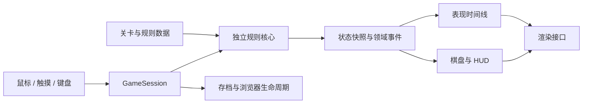

# 连线战斗游戏：第一版代码架构方案

日期：2026-10-14，关卡扩展更新于 2026-10-16。本文是第一版实现规范。当前落地固定三个关卡、第四关起无限生成、像素表现与基础动画、输入交互、本地存档与 PWA；已加入关间商店、生命回复、双倍宝石及三个消耗道具栏；永久装备升级和能力成长仍留待后续。

采用 **TypeScript 独立规则核心 + Canvas 2D 几何表现 + DOM 操作界面 + Vite 静态构建**。同一份游戏在电脑浏览器和手机浏览器运行；通过 PWA 支持主屏幕入口与离线游玩。源代码放在 `demos/chain-game/`，发布到 `public/games/chain-game/`，复用当前网站的 GitHub Pages 部署方式。

第一版要做完整的“规划连线 → 击杀与取宝石 → 承担落点风险 → 棋盘更新 → 达标后选择撤离”循环。后续换人物、怪物、背景和动画时，规则代码与关卡数据应继续使用。

## 1. 视频依据与复刻边界

参考用户提供的本地视频 `20261014_171342.mp4`，约 17 分 19 秒。本次采用全片分段抽帧，并对教学、攻击范围和失败过程加密查看。以下时间为近似视频位置；视频中的教学文字是玩法证据。

| 视频位置 | 可确认的行为 | 架构含义 |
| --- | --- | --- |
| 00:06、00:30–00:46 | 从主角位置选择相邻同色怪物，路径包含斜向；选线后有 GO 确认 | 主角必须有位置；路径规划与执行分离；连线使用八方向邻接 |
| 00:46–01:04 | 10 连之后出现宝石；宝石留在棋盘上 | “生成奖励”与“收集入袋”分开，不能只加一个分数 |
| 01:07 | 教学明确说明经过宝石可以转换攻击颜色 | 宝石是换色节点；换色后重新锁定下一个普通怪的颜色 |
| 01:50 | 教学说明更长攻击链得到更多宝石收益 | 奖励阶梯必须是独立数据，不能与绘制混写 |
| 03:20–03:42 | 目标为 55；达标开门，还能继续游玩；教学提示倒下会失去所有战利品 | 区分目标完成、出口开启、成功撤离、本局未结算战利品 |
| 04:46–05:00 | 教学说明停在红色危险格会被攻击；可以查看愤怒敌人的范围 | 主要风险由终点和存活攻击者决定；提供危险预览 |
| 05:04 | 被查看的蓝色愤怒怪显示十字形范围，没有显示对角格 | 普通怪第一版采用四方向攻击；攻击邻接与连线邻接分别定义 |
| 09:18 附近 | 后一关有不同棋盘形状、颜色与带耐久数字的木箱 | 棋盘形状、实体类型、关卡目标使用数据配置；木箱留到后续实现 |
| 15:44、15:54–15:58 | 玩家剩两颗心，最后一轮攻击后归零，战利品从 5 清零 | 一回合可能损失多颗心，不能设定“一轮最多扣 1”；准确逐只伤害仍待校准 |

另外，CAPY 主程 Kenneth Yeung 在[开发者 AMA](https://www.reddit.com/r/Grindstone/comments/i1a9e4/were_the_grindstone_game_developers_from_capy_ask/)说明：颜色生成使用纯随机；随机过程可确定性复现。同一页面中创意总监也说明宝石可以连接不同颜色，删除怪物会使上方怪物下落。该资料支持采用种子随机和下落补充，无需先做智能发牌。

**尚不能由这段视频精确反推出的数值与边界**：所有奖励档位、宝石生成格、愤怒抽样概率、每只怪的完整攻击规则、出口与敌袭的优先级，以及所有结算阶段的细小先后关系。下面给出可直接实施的 V1 默认方案，并将这些选择标为“暂定”；它们不是已经验证的原作源码规则。未来逐项校准时只调整规则模块和配置。

操作细节同时采用用户后续明确要求及外部一手资料。已补充原作键鼠控制图、开发者访谈及对应证据范围，见[选线与输入交互规范](chain-game-input.md)。左键点击与拖拽选线、无效连接无响应、反向回退、松开后右键单步回退均为本项目确定需求；点击可连接的愤怒方块时选线优先于范围查看。

## 2. 第一版范围

保留三个固定关卡：第一关为 **6 行 × 5 列新手关**，使用苹果、橙子、黑莓三种水果；第二关为 **7 行 × 7 列标准关**，使用橙子、梨、黑莓、苹果四种水果；第三关沿用第二关的尺寸、四种水果及普通愤怒规则，增加门口精英，要求累计击杀至少 60 个并击败开场精英才开门。用户尺寸统一按行 × 列表示；代码仍明确使用 `height = 行数`、`width = 列数`，只计算棋盘内部可玩格，不包括外围边框与格外出口。固定关与第四关起的生成关共用主角、宝石、愤怒状态、连线预览、回合结算、击杀目标、出口、成功/失败、本地恢复与重新开局。生成关按世界种子、实际编号和版本确定，详见[无限关卡实现](chain-game-endless-levels.md)。

生命是跨关卡的永久状态：新存档初始 3 点，行动造成的损失立即同步进 Profile。过关、切换关卡、重试、刷新均不回血。第二关及以后通关后，关间商店可花宝石回复生命；教程关后跳过商店。生命归零后不能进入商店、重试或进入下一关。测试时可由玩家明确选择“重置整个存档”，同时清空余额和关卡进度并建立全新角色；它不是免费治疗或普通重试。

主角用圆圈或 P 标记，怪物用色块加字母/符号，宝石用带价值数字的菱形，愤怒用描边和感叹号，出口用简单方框。棋盘仅有网格和底色。颜色之外保留符号，方便识别。使用基础几何动画呈现持续动线、沿线冲撞、碎片和补块下落；人物插画与场景美术仍保留替换接口。

固定关从静态 `LevelDefinition[]` 读取，生成关在开局前按需建立完整定义并保存到本局快照；成功撤离前一关后解锁下一关，菜单只展示有限入口。后续增加“成功撤离 → 用宝石打造/升级装备、升级角色能力 → 携带成长进入下一局”的长期循环，详细设计见[装备与角色成长系统](chain-game-progression.md)。第一版规则接口支持空装备与零级能力，成长功能按第 13 节后续阶段接入。Boss、木箱玩法、美术地图选关、账号与联网排行继续留待扩展。

## 3. 模块划分与依赖方向



依赖只能从外层指向核心。核心不导入 DOM、Canvas、React、图片、音频、计时器、存储或具体渲染引擎。规则不依赖帧率，只有有效行动推进回合。

| 模块 | 职责 | 不承担的职责 |
| --- | --- | --- |
| `core/model` | 棋盘、实体、玩家、局内收益、回合状态 | 图片与屏幕坐标 |
| `core/path` | 邻接、颜色锁定、宝石换色、路径回退、提交校验 | 鼠标/触摸事件 |
| `core/turn` | 明确顺序的回合结算，输出新状态和事件 | 等待动画播放 |
| `core/reward` | 击杀统计、宝石档位、生成位置、拾取 | HUD 数字动画 |
| `core/threat` | 攻击范围、伤害、愤怒升级 | 用贴图颜色判断危险 |
| `core/combat`、`core/effects` | 逐次攻击记录、防御次数、长链收益修正 | 购买或升级永久装备 |
| `core/board` | 带形状的格子、重力、补怪、可行动检查 | 根据玩家表现偷偷调色 |
| `core/random` | 可保存、可重放的伪随机状态 | `Math.random()`、系统时间 |
| `content` | 关卡、敌人、装备、能力、价格及数值表、主题标识 | 包含函数的存档数据 |
| `progression` | 永久装备与能力、消费校验、换装、开局效果快照 | 实时改变进行中对局的能力 |
| `application` | 会话、预览、提交防重、暂停、保存 | 重新实现一套伤害计算 |
| `application/path-editor` | 路径草稿、追加、截断、单步回退、取消拖拽 | 撤销已经提交的战斗回合 |
| `presentation` | 几何绘制、UI、输入、事件播放、美术映射 | 改写生命或决定击杀 |
| `platform` | 本地存储、PWA、页面生命周期 | 连线规则 |

不引入 ECS、通用插件总线或大型游戏引擎。现阶段采用明确的纯函数和小接口足够；未来如采用 PixiJS/其他表现方案，通过渲染适配器替换。

建议目录：

```text
demos/chain-game/
  index.html
  vite.config.ts
  src/
    main.ts
    core/
      model.ts
      path.ts
      turn.ts
      reward.ts
      threat.ts
      combat.ts
      effects.ts
      board.ts
      random.ts
      events.ts
    content/
      levels/level-001.ts
      levels/level-002.ts
      levels/index.ts
      enemies.ts
      rules-v1.ts
      themes.ts
      equipment.ts
      abilities.ts
    progression/
      model.ts
      commands.ts
      build.ts
    application/
      game-session.ts
      path-editor.ts
      replay.ts
      save-schema.ts
    presentation/
      contracts.ts
      view-model.ts
      canvas-renderer.ts
      animated-turn-presenter.ts
      motion.ts
      pointer-input.ts
      keyboard-input.ts
      hud.ts
      camp.ts
      styles.css
    platform/
      local-storage.ts
      lifecycle.ts
  tests/
    path.test.ts
    turn.test.ts
    replay.test.ts
    save.test.ts
    progression.test.ts
    effects.test.ts
    path-editor.test.ts
scripts/build-chain-game.ts
public/games/chain-game/       # 构建产物
components/chain-game-experience.tsx
```

上述是完整扩展结构。首版把相关小模块归并在 `core/board.ts`、`core/path.ts`、`core/turn.ts`、`content/levels.ts`、`application/session.ts`、`application/path-editor.ts`、`presentation/input.ts` 和 `platform/storage.ts` 等文件内，避免为尚未启用的成长功能创建空实现。扩展时沿用上述职责边界。

## 4. 数据模型：棋盘形状、实体和美术分开

静态地形与动态占位分开。一个可走格至多一个占位实体；主角单独保存状态，但其位置参与占位检查。实体有稳定 `id`，下落只改位置，不丢失愤怒、出生回合等状态。不要把愤怒或耐久存成某个格子的附加颜色。

以下是包含后续成长的合同示意；首版真实类型在 `src/core/model.ts` 与 `src/application/session.ts`。为保持实现紧凑，当前采用如下名称映射：`Profile.id` 对应示意中的 `profileId`，`bankedGems` 对应 `bankedGrindstones`，`RunState.carriedGems` 对应 `carriedLoot.grindstones`，实体使用 `kind: 'gem'` 和 `color`；当前奖励只有数值，没有宝石外观等级。账户版本保存在外层 `SessionData.revision`。装备栏与消费命令记录留待成长阶段加入。代码中的 `health / maxHealth` 是已实现的永久生命字段。

```ts
type Cell = Readonly<{ x: number; y: number }>;
type ColorId = string;
type EntityId = string;

type BoardEntity =
  | {
      kind: 'creep'; id: EntityId; pos: Cell;
      archetypeId: string; colorId: ColorId;
      bornTurn: number;
      mood: 'calm' | 'angry';
      attackActiveFromTurn: number | null;
    }
  | {
      kind: 'grindstone'; id: EntityId; pos: Cell;
      value: number; tierId: string;
    };

interface RunState {
  runId: string;
  levelId: string;
  levelSnapshot?: LevelDefinition; // 生成关完整定义，getRunLevel 优先读取
  rulesVersion: string;
  contentVersion: string;
  revision: number;
  turn: number;
  status: 'playing' | 'escaped' | 'dead';
  player: { pos: Cell; hp: number; maxHp: number };
  build: RunBuildSnapshot;
  equipmentRuntime: Readonly<Record<string, { remainingCharges: number }>>;
  entities: Readonly<Record<EntityId, BoardEntity>>;
  killCount: number;
  shortChainCount: number; // 本关累计短链行动，旧存档缺省 0
  carriedLoot: { grindstones: number };
  pendingDrops: readonly { value: number; tierId: string }[];
  exitUnlocked: boolean;
  rng: { board: number; rage: number; rewards: number };
  nextEntityId: number;
}

interface Profile {
  profileId: string;
  revision: number;
  health: number;
  maxHealth: number;
  bankedGrindstones: number;
  equipment: Record<string, { level: number }>;
  loadout: Partial<Record<EquipmentSlot, string>>;
  abilityLevels: Record<string, number>;
  appliedProgressionCommandIds: string[];
  clearedLevelIds: string[];
  settledRunIds: string[];
}
```

`carriedLoot` 是本局尚未带出的战利品；`bankedGrindstones` 是成功带出并扣除消费后的可用余额，不是历史累计获得量。打造与升级只能花这个余额。失败仅清除当前局携带收益及待放置奖励，已拥有的装备与能力等级保留。只有成功撤离才转入账户，`runId` 确保重复点击或恢复页面不会重复入账。棋盘上的未拾取宝石及 `pendingDrops` 不属于携带收益，撤离时不计入账户。

`RunBuildSnapshot`、`EquipmentSlot` 和效果类型在成长系统文档中定义。开局将装备及能力解析为不可变 `build`；回合只读取这份快照和 `equipmentRuntime`，不查询最新的 Profile。空装备/零能力同样生成合法空快照。

`resolveTurn` 只计算局内状态与 `RunEscaped` 事件。`GameSession` 收到成功终态后调用纯函数 `settleProfile(profile, run)`，按 `runId` 幂等结算，再将两份状态写入同一个存档信封。撤离后的 `carriedLoot` 保留为本局结果快照，不能再次消费或入账；是否已入账由 `settledRunIds` 判定。规则核心不读取或写入存储。

`revision` 在每次有效提交后递增。选线草稿、当前查看范围的方块、悬停、屏幕大小、动画进度存在应用/表现层，不混进规则存档。核心只接收提交后的行动。

## 5. 路径规则与操作

1. 从当前主角格出发，第一步必须相邻；连线邻接采用八方向，不允许跳格。
2. 第一个普通怪确定本段颜色；本段只能继续连接同色普通怪。
3. 宝石可从任意颜色进入。经过宝石后取消颜色锁定，下一个普通怪重新确定颜色；允许连续经过宝石，允许以宝石为终点。不能因此忽略邻接和重复访问限制。
4. 同一实体不可重复访问。按住左键往回拖至前一个节点即撤回最后一步，继续后拖可继续回退并改走其他分支。拖至更早历史节点时截断后面的草稿，拖回主角清空；“直接触碰更早节点截断”是本项目补齐的默认规则。
5. 路线允许几何线段交叉，包括对角交叉，但不能重复选择同一个节点。回拖到已选节点仍按截短草稿处理。
6. 普通攻击最短允许 1 只怪，另支持只拾取相邻宝石、或相邻出口撤离。视频出现 1、2 连的 GO 预览，不应套用三消的“三个起步”。空路径无效；出口作为独立终止节点，不能继续穿过。
7. 暂定不允许沿空格任意移动，也不添加“等待一回合”按钮，避免产生新规则。

区分路径节点数、有效连击数 `preview.chainCount`、路线水果击杀数 `preview.kills`、关卡总击杀 `killCount` 和拾取价值。每个路线水果与宝石节点各贡献 1 连，出口不计入；宝石堆无论价值多少都只算一个节点。奖励门槛和 GO 数字使用 `chainCount`，例如 9 个水果与一堆宝石达到 10 连。拾取宝石不增加 `kills` 或关卡击杀，连斩加速仍只随人物斩击的水果数量推进。奖励宝石砸坏的水果只增加关卡总击杀，可推动开门；不增加连击、连斩速度或递归触发奖励。

电脑以**鼠标左键点击或按住拖拽**编辑路径。按下时不改线，移动超过 6 CSS 像素后从原按下点开始采样；未拖拽即松开则处理点击。点击与拖拽共用 `editPath`，主角清空、旧节点截断、当前尾点不操作、合法下一步追加。仅悬停不会追加节点；尝试新增异色、非相邻、墙等不可连接目标时，已有路径、终点与预览保持不变，不自动修路。已选节点先按回退规则处理，不受新增节点的颜色/邻接限制。松开左键保留草稿，不执行。松开后，每次右键点击仅删除最后一个路径节点；回退可跨宝石节点，并重新计算颜色约束、奖励和危险预览。

可再次左键按下并拖动续接或重新规划，最终点击独立“执行”按钮或按 Space / Enter 提交。Backspace / Delete 映射为同一单步回退，Esc 打开菜单；Tab / Shift+Tab 保留正常网页焦点导航。界面移除回退、清空和全局危险范围按钮。具体焦点和按住行为按交互规范执行。撤销仅影响未提交草稿，已执行的回合不回滚。

点击优先处理路线编辑：能够作为当前路线下一步的愤怒方块、宝石或出口直接选入，不同时显示攻击范围；旧节点、当前尾点和主角也优先按路线规则处理。只有不能用于路线编辑的愤怒方块，点击后才查看攻击范围：普通愤怒水果为上下左右，精英为周围八格，以缓慢闪烁的红色方框表示；一次只查看一个方块，点击另一可查看的愤怒方块切换，点击空白或其他目标关闭。普通平静方块和宝石没有攻击范围。范围查看本身不编辑已有路线；手势取消、指针捕获丢失或失焦不触发点击编辑或查看。开始执行、打开菜单或进入新关卡时清空查看状态；减少动态效果模式下红框常亮。

手机使用单指轻点或拖拽选线、抬手保留，与电脑共用移动阈值和点击优先级；只有不能用于路线编辑的愤怒方块才通过轻点显示范围。通过轻点或拖回已选旧节点回退、轻点或拖回主角清空，只提供独立“执行”按钮。触摸中断、切后台或第二根手指不会提交，同一页面内保留有效草稿；棋盘版本改变、重新开局或整页重载时清除旧草稿。快速移动的采样、无效节点处理、再次按下的续接规则及浏览器右键菜单处理见[交互规范](chain-game-input.md)。

## 6. 统一预览与提交

```ts
type TurnCommand = {
  runId: string;
  revision: number;
  targets: readonly string[]; // 实体 ID；'exit' 只可出现在末尾
};

type TurnResult =
  | { ok: false; error: string }
  | { ok: true; state: RunState; events: GameEvent[]; preview: TurnPreview };

function resolveTurn(
  state: RunState,
  command: TurnCommand,
): TurnResult;

function previewPath(
  state: RunState,
  targets: readonly string[],
): TurnPreview;
```

预览与提交共享同一套路径解析、伤害和奖励函数。点击编辑、拖拽追加、拖回和右键回退均由 `path-editor` 修改草稿，再调用同一预览函数。预览在副本上调用结算，或复用结算的确定阶段；不得推进真实随机状态、写存档或发放收益。提交必须同时检查命令的 `runId` 和 `revision` 是否与当前对局匹配，防止双击执行、上一局的旧草稿或动画期间的输入重复结算。

核心预览分别保留有效连击 `chainCount`、路线水果击杀 `kills`、拾取价值、奖励、终点与最终扣血。当前界面只在 GO 内显示有效连击，以及预计落下的宝石堆大背景，连击数、GO 和键帽位于背景上层；奖励为零时不显示宝石，不显示 `+数值`、拾取价值或伤害指标。`rewardCount` 为实际放置的各宝石堆 `value` 之和，含本轮可放置的旧 `pendingDrops`；`rewardValue` 为本轮路线新获得的奖励价值。点击方块时的范围红框只表示该愤怒怪的攻击区域；落点伤害仍按全部存活攻击者计算，被本路径击杀的愤怒怪不贡献伤害，随后才被宝石砸坏的愤怒怪仍先攻击。核心已经支持防御和奖励效果，预览不消耗真实防御次数。

公开 UI 只暴露本轮决定所需信息，不显示下一轮随机补色和新愤怒抽签结果。开发调试视图可看完整模拟结果。预览次数、取消次数和移动手指的次数必须不影响随机序列。

## 7. 第一版回合时序

下列顺序为 V1 的明确默认合同，原作尚未完全确认的先后关系由 `rulesVersion` 标识。核心同步计算完整结果，表现层随后按事件播放。

```text
校验版本、路径、颜色和出口
  → 冻结本轮可攻击的敌人及其攻击位置
  → 按路径击杀、拾取，主角移动到终点
  → 累加击杀，检查出口是否解锁
  → 若路径合法到达已开启出口：成功撤离并停止
  → 判定并累计本关短链次数
  → 存活且本轮已经可攻击的敌人生成独立攻击记录
  → 按固定防御规则消耗盾牌次数，抵消符合条件的攻击
  → 扣血；死亡则丢失局内收益并停止
  → 短链时从已有平静普通水果抽取惩罚变异（下一轮才攻击）
  → 按有效连击数（水果与宝石节点）计算基础奖励及本局能力加成
  → 先旧后新放置奖励宝石堆，随机砸坏幸存水果，无水果时以空格兜底
  → 累加砸坏数量并再次检查开门，不增加连击或递归产奖
  → 下落、补怪；达到击杀进度门槛后，每个新普通水果以 1/15 概率愤怒
  → 回合与 revision 增加，输出稳定状态
```

实施时一轮使用局部 `actionTurn = state.turn + 1`；本轮新愤怒设置 `attackActiveFromTurn = actionTurn + 1`。结束时令 `turn = actionTurn`。成功/死亡终态也增加一次回合和版本。无效行动完全不改变状态。

几个必须写清的边界：

- **落点风险**：按行动开始时已显示的攻击格判断，先移除路径中被杀的攻击者；路过危险格不触发伤害。结算攻击在下落前，避免玩家预览安全的落点因补位突然受伤。
- **伤害叠加与防御**：普通愤怒怪暂定每只命中扣 1；每次命中保留为独立 `AttackIntent`。先由装备抵挡部分攻击，再汇总剩余伤害一次扣血，上限自然为剩余生命。无盾时等同原始叠加规则。一点盾牌次数抵挡一次符合条件的小怪攻击，不能把整轮多次攻击合并成一次来抵挡。视频支持多心损失，但不证明所有敌人都恰好 1 点。
- **新愤怒**：显示危险后留给玩家一轮规划，不在刚升级时偷袭。惩罚只抽取本轮已有幸存的平静普通水果；新补位水果不参加惩罚抽样，另走进度门槛后的 1/15 概率。死亡回合不保留额外变异，不生成奖励或补位。
- **出口**：路径校验读取已有总击杀加上当前前缀的水果击杀，并在精英关计入前缀精英击杀；门虽在行动开始时锁着，只要前缀满足目标且尾点位于入口格，即可将出口接入同一路线。宝石只增加连击，不增加击杀；不可用撤离后才可能发生的奖励砸击预先满足目标。规则提交先处理沿途击杀、解锁并发出 exit-opened，再执行成功撤离；撤离不受本轮邻怪攻击，也不产奖励或补位。预览拖到门上时播放像素开锁，撤回时反向复锁，不修改真实 exitUnlocked；已实际解锁的门保持开启。
- **重力**：主角不下落、不被覆盖；墙、主角和暂定固定在格上的宝石切分垂直区段。区段内怪物保持相对顺序向下压实，再在区段上部补怪；格子数小，无需物理模拟。宝石是否跟随下落单独由 `falls` 行为配置，V1 暂定不下落，待对照视频校准。
- **终态**：死亡后不再生成或放置奖励、补怪或升级；携带收益清零。成功后结算账户，不生成奖励，本局不再接受行动。

攻击、生成、下落、升级的执行顺序由 `turn.ts` 显式调用各函数，不能交给任意事件订阅者的注册顺序。以后需要调整原作时序，修改这一处及相应行为用例。

## 8. 奖励、愤怒和随机布局

宝石是棋盘上的实体：长链生成宝石，之后连接它才把价值加入本局携带收益；带出关卡后才永久入账。宝石价值与绘制大小分别存储。

能力对本轮奖励的修正只在生成时应用一次，最终价值写入宝石实体或 `pendingDrops`。拾取仅移动已有价值，撤离仅入账，不重复加成。无基础奖励时不因长链增益凭空发奖；详见成长系统的收益公式。

暂定奖励表：

| 本轮有效连击数（水果与宝石节点） | 新生成宝石的价值 |
| --- | --- |
| 1–9 | 0 |
| 10–14 | 1 |
| 15–19 | 2 |
| 20–24 | 3 |
| 25 及以上 | 5 |

除“10 连已经出现宝石”外，这些分档是可玩原型的暂定数值，并非完整复刻结论。每轮新奖励为一个 `value=N` 的完整宝石堆，只占一个落点，不拆成 N 个实体；已有 `pendingDrops` 可使同轮落下多个独立宝石堆。棋盘与 GO 共用 `gemClusterPlacements(N)` 的堆叠外观。

生成位置优先从路线与终点攻击结算后仍存活的普通水果中抽取，排除主角格和精英，候选按稳定实体 ID 排序，以独立的 `rewards` 种子随机流选择一个。整堆宝石占据目标格并砸坏该水果；没有普通水果候选时才从合法空格中随机选点，仍无位置则保留在 `pendingDrops`，下一轮补位前重试。旧待放置奖励先于本轮新奖励处理，已有宝石、精英、主角和墙不被覆盖。砸坏计入 `killCount`，不改变 `preview.kills`、`preview.chainCount` 或本轮基础奖励，且不会撤销已经结算的攻击。预览在副本上模拟相同流程，不推进真实随机流。

固定关与生成关的普通水果开场全部平静。第 N 关用实际关卡序号计算短链门槛 `min(3 + N, 8)`，第一、二、三关分别为 4、5、6。每个有效行动的 `chainCount` 小于门槛时，本关累计一次短链行动；前两次各使 1 个已有平静普通水果愤怒，第三次及以后每次使 2 个愤怒。长链不清零累计次数，水果和每堆宝石各计 1 连，出口不计；预览、回退、无效命令不累计。候选为斩击后仍存活、本轮行动前已有的平静普通水果，按稳定实体 ID 排序，用 `rng.rage` 无放回抽样；候选不足取全部。既有愤怒水果和精英不参加，已愤怒状态持续保留。

核心先结算终点已有攻击者和扣血，存活时才执行惩罚变异，随后处理奖励和重力补位。表现层将存活回合的变异在路线执行后立即显示，使玩家及时看到惩罚；新变异设置下一轮才可攻击，当前回击只取行动开始时已经有攻击资格的敌人。若本轮最终死亡或成功撤离，不执行变异，不生成奖励或补位。本关累计短链次数写入 `RunState.shortChainCount`，换关或重开归零，旧存档缺省 0，保留原有棋盘与生命。

补位愤怒独立于短链惩罚：累计 `killCount >= goal × max(1 / N, 1 / 10)` 后，每个新生普通水果独立以 `1/15` 概率愤怒，使用 `rng.rage`；第一关在 20 击杀起，第二关在 28 击杀起，第三关在 20 击杀起启用。这个门槛随关卡序号降低，最低为目标的十分之一；只对补位生效，开场不会概率生成普通愤怒水果。第三关与生成守门关的精英始终愤怒，其 1/40 补位抽样与普通愤怒概率分别处理；其他生成模板不启用精英刷新。

第二、三关初始布局和三关后续补怪采用种子 PRNG，按固定格序抽取颜色，各关配置内水果等权。第一关仅开场使用固定教学布局，确保能体验长链；预置开场不消耗补怪随机流。第三关开场精英的格子固定，击败它后补怪时才开放精英抽样。`board`、`rage`、`rewards` 使用独立随机流，算法版本固定。初始 seed、新局内容版本、开局构筑快照、随机状态和有效命令日志可导出重放；同 seed 只有在同规则版本、同初始关卡、同构筑和同命令顺序下才保证相同结果。美术粒子的随机数完全独立。

固定首关保留教学长链；生成关建立候选时预留普通 4～7 连、长链模板 8～12 连（普通与长链回退布局保留 8 连），守门模板保证精英至少在第 10 连可选入。每关最多 24 次候选，每个候选最多 1600 个搜索节点，失败使用已知可用回退布局；颜色分布保持平衡。开局约束不承诺每次补位都有长链。合法行动检查先判断相邻可攻击实体、宝石或已开出口，不求全局最长路线，也不因没有安全解就自动重排。异形地图与明确卡局恢复属于后续功能。


### 关间商店与消耗道具

教程关撤离后直接进入第二关。此后每次成功撤离先将宝石入库，再随机展示八种商品中的三个：5 宝石回复 1 点生命、10 宝石回复 2 点生命、10 宝石购买下一关拾取宝石 ×2、25 宝石护盾、25 宝石瞬移药水，以及 15 / 25 / 50 宝石购买 +3 / +5 / +10 连击药水。每格本轮只能购买一次，5 宝石刷新三格，库存不足或对应条件不满足时禁止购买。

`application/shop.ts` 保存商品目录和独立随机抽样；`SessionData.shop` 保存货架、购买记录、随机状态、刷新次数和关闭状态。购买、刷新和离店均在进入动画前持久化。`Profile.inventory` 与 `RunState.inventory` 同步保存最多三个消耗道具；生命回复和下一关增益不占道具栏。旧存档的可选字段按空库存与普通收益读取。

连击药水选中后立即改变预览，确认有效的非空节点路线才消耗；增加连击奖励、精英前缀门槛及短链判定，但不增加实际击杀。护盾在受击回合自动消耗一面，防住所有同时结算的攻击。瞬移交换主角与普通水果或宝石的位置，不推进回合，不触发拾取或攻击，不可选择精英或门。道具操作提高 revision，不增加 turn，路线历史长度仍与 turn 一致。双倍宝石仅翻倍本关实际拾取量，离开或重试结束效果。

## 9. 关卡配置与扩展

当前提供三个固定关卡，并从第四关起按需生成后续关卡。采用视频第一关“连线 → 长链宝石 → 换色 → 开门 → 撤离”的教学顺序，首关降低达标要求；视频记录中的 55 击杀仍是原作观察值，首关 20 击杀为本项目的简化暂定值，第三关的精英与 60 击杀组合目标按用户新增规则实现。

| 配置 | 第一关：新手关 | 第二关：标准关 | 第三关：精英守门关 |
| --- | --- | --- | --- |
| 可玩棋盘 | 6 行 × 5 列，共 30 格 | 7 行 × 7 列，共 49 格 | 7 行 × 7 列，共 49 格 |
| 起点（从 0 计数） | `(2, 5)`，底部正中 | `(3, 6)`，底部正中 | `(3, 6)`，底部正中 |
| 初始怪物数 | 29，留出主角格 | 48，留出主角格 | 48，其中 1 个为门口精英 |
| 水果与生命 | 苹果、橙子、黑莓，读取 Profile 当前生命 | 橙子、梨、黑莓、苹果，继续保留当前生命 | 沿用第二关水果与当前生命 |
| 开门目标 | 击杀 20 只，暂定 | 击杀 55 只，暂定 | 击杀至少 60 只，并击败开场精英 |
| 通关条件 | 开门后沿合法路径从出口撤离 | 开门后沿合法路径从出口撤离 | 开门后沿合法路径从出口撤离 |
| 开场 | 固定布局，包含从起点出发的 10 连路径 | 种子随机布局 | 随机布局，精英固定于 `(3, 0)` |
| 补怪 | 三种水果等权随机 | 四种水果等权随机 | 四种水果等权随机；首个精英死后，无精英时每个新水果有 1/40 概率成为精英 |
| 愤怒 | 少于 4 连触发短链惩罚；20 击杀起补位有 1/15 概率愤怒 | 少于 5 连触发短链惩罚；28 击杀起补位有 1/15 概率愤怒 | 少于 6 连触发短链惩罚；20 击杀起补位有 1/15 概率愤怒；精英始终愤怒、攻击八方向 |
| 解锁 | 初始开放 | 成功撤离第一关后开放 | 成功撤离第二关后开放 |

三关都没有内部墙、木箱或额外采集门槛，外围边框不占可玩格。保留 `mask` 以支持以后加入不规则地图。第三关的精英作为独立敌人原型加入，开门需额外读取本局首次精英击杀记录。配置示意：

```ts
const level001 = {
  id: 'level-001',
  version: 1,
  width: 5,
  height: 6,
  mask: Array(6).fill('.....'),
  playerStart: { x: 2, y: 5 },
  exit: {
    id: 'north',
    entryCells: [{ x: 1, y: 0 }, { x: 2, y: 0 }, { x: 3, y: 0 }],
  },
  objective: { type: 'kill-count', target: 20 },
  colorWeights: { blue: 1, red: 1, purple: 1 },
  enemyPool: [{ archetypeId: 'basic-creep', weight: 1 }],
  initialSpawn: {
    mode: 'preset',
    legend: { B: 'blue', R: 'red', P: 'purple' },
    rows: ['RBRPR', 'BBPRP', 'BBRPR', 'RBBBP', 'RPBBR', 'PR.PR'],
  },
  levelNumber: 1, // 普通愤怒门槛统一按实际关卡序号计算
  unlock: { type: 'always' },
  tutorialId: 'basics',
  rulesId: 'prototype-v1',
  themeId: 'debug',
};

const level002 = {
  id: 'level-002',
  version: 1,
  width: 7,
  height: 7,
  mask: Array(7).fill('.......'),
  playerStart: { x: 3, y: 6 },
  exit: {
    id: 'north',
    entryCells: [{ x: 2, y: 0 }, { x: 3, y: 0 }, { x: 4, y: 0 }],
  },
  objective: { type: 'kill-count', target: 55 },
  colorWeights: { blue: 1, green: 1, purple: 1, red: 1 },
  enemyPool: [{ archetypeId: 'basic-creep', weight: 1 }],
  initialSpawn: { mode: 'random' },
  levelNumber: 2, // 普通愤怒门槛统一按实际关卡序号计算
  unlock: { type: 'level-cleared', levelId: 'level-001' },
  rulesId: 'prototype-v1',
  themeId: 'debug',
};

const level003 = {
  ...level002,
  id: 'level-003',
  objective: { type: 'kill-count-and-elite', target: 60, minEliteKills: 1 },
  elite: { initialPos: { x: 3, y: 0 }, minChain: 10, respawnChance: 1 / 40 },
  unlock: { type: 'level-cleared', levelId: 'level-002' },
};

const levels = [level001, level002, level003];
```

首关 `initialSpawn.rows` 的 `.` 仅表示保留主角格，其他符号映射普通怪颜色。可选的 10 连示例是 `(2,5)` 起点后依次经过 `(2,4) → (3,4) → (3,3) → (2,3) → (1,3) → (1,2) → (0,2) → (0,1) → (1,1) → (1,0)`，均为蓝色且八方向相邻。它是教学示例，不要求玩家照着走。

新手提示由已有状态与事件触发：开场说明拖拽和回退；首次生成宝石说明换色；达到 20 击杀后说明出口和撤离；首次短链惩罚或概率补位产生愤怒时说明危险落点。提示可跳过，不冻结成必须完成特定长链的任务，也不额外要求“必须拾取宝石／必须被攻击”才能过关。阅读、关闭提示和刷新不推进回合，不控制怪物升级。

首关和后续关卡共用第 8 节的短链惩罚及进度补位概率，不再以开门状态或第 6 回合作为普通愤怒激活条件。合法撤离会提前结束回合，不为教学强制留场。

第三关的开场精英固定于门前 `(3, 0)`，始终愤怒，攻击周围八个合法相邻格，每次造成 1 点伤害。精英仍需相邻且遵守同色／宝石换色规则；校验连接前缀时，只有把精英自身计入后有效连击数达到 10，才允许将其加入路线。每个水果与每堆宝石各计 1，出口不计；不能先选入精英，再靠其后节点补足 10 连。精英不可被奖励宝石覆盖或砸死，并作为固定边界阻挡重力下落。

本局首次精英击杀后，后续补怪在当前没有精英时，对每个新生水果按 1/40 概率生成精英，一旦生成便停止本轮其余位置的精英抽样；同时最多一只，颜色仍来自本关四种水果。随机精英同样固定、始终愤怒，新生精英从下一轮才有攻击资格。`RunState.eliteKills` 保存本局累计精英击杀数，旧存档缺省按 0；只要该值至少为 1，首次击杀门槛便永久满足，后续刷新精英不会重新锁门。总击杀达到 60 与首次精英击杀可按任意先后完成，两个条件都满足才开门。

入口和出口连接作为关卡显式数据，出口是棋盘外的终止节点，不把坐标 −1 用于棋盘数组访问。当前单出口版本在撤离后把 `player.pos` 设置为 `level.exit.pos`，只在 `status === 'escaped'` 时允许此格外位置；回合立即结束，不对它执行攻击、重力或填怪。入口格选择为本项目配置，固定关与生成关均采用顶部中央三格。加载时校验 `mask`、预置行列尺寸、主角空位及入口坐标；所有 `.` 地形格均可玩，主角格禁止填怪。未来多出口版本可额外保存出口 ID。

固定关进度继续使用 `Profile.clearedLevelIds`。只有前一关 `escaped` 并完成一次性结算后才解锁下一关，达标开门但死亡不能解锁；已有第二关通关记录的存档直接开放第三关。第三关成功撤离后进入第四关，此后持续生成并自动衔接下一关，不再显示通关确认弹窗。菜单保留固定三关、当前生成关和最高已解锁生成关的有限入口，使用 `getNextSessionLevelId` 与 `getAvailableEndlessLevelIds` 查询，不预建长数组。

生成关采用 `endless-v1-N-seedhex` ID；`generation: { version: 'v1', worldSeed, stageSeed, template }` 写入完整 `LevelDefinition`，并通过 `RunState.levelSnapshot` 固定到本局。`getRunLevel(state)` 优先快照，固定老关再查静态目录；核心、输入和表现共用它。会话可选 `endless: { worldSeed, generatorVersion: 'v1', highestUnlocked }` 保存世界与最高连续进度，不向固定通关数组无限追加记录，当前生成局另以 `lastSettledRunId` 防止重复结算。布局使用独立种子流，同世界同编号重试保持相同开局；旧存档保留原固定局，缺少连续字段时按需建立。

进入新关创建独立 `runId`，回合、总击杀、精英击杀、短链次数、棋盘、命令历史和装备次数按新局初始化；生命从 `Profile.health` 继承，绝不补满。保留账户余额、永久成长与通关记录，不携带上一局草稿和未拾取宝石。每次伤害结算时同步保存 Profile 生命与 RunState，普通重试也继承这一生命值。生命回复仅在商店购买。生命归零后先保存完整死亡结果供表现层播放；动画完成后进入持久化的复活整备，清空随身道具、把生命置为 1、生成独立货架，并允许重开本关或选择其他已解锁关。完整生成规则与边界见[无限关卡实现](chain-game-endless-levels.md)。

新增关卡通过配置定义形状、起点、出口、颜色权重、敌人池、目标、愤怒配置和主题。当前支持击杀计数，以及配置精英时附加的首次精英击杀要求；以后增加采集等目标处理器。

敌人定义应包括 `id`、匹配颜色行为、攻击范围偏移、伤害、升级策略和表现键。普通怪攻击范围使用 `[{dx:0,dy:-1},{dx:1,dy:0},{dx:0,dy:1},{dx:-1,dy:0}]`。新增敌人不能要求所有渲染代码新增一套规则判断。

从第四关起每五关循环“舒缓 calm → 标准 standard → 长链 long-chain → 压力 pressure → 守门 guardian”，守门关为第 8、13、18……关。棋盘固定 7×7，目标按区间和模板在 55～95 内封顶，沿用现有水果和宝石档位；精英门槛保持 10，普通愤怒按实际关卡 N 计算，不增加额外同时存在上限。世界种子与编号派生的 `stageSeed` 决定初始布局；生成候选不消耗关内 `board`、`rage`、`rewards` 流，不读取当前生命或操作表现调难度。

## 10. 美术、动作、击杀、场景的接口

人物、怪物与场景保留美术替换入口。V1 使用几何形状，并提供持续动线、主角沿路线移动、逐个碰撞碎裂以及延迟补块下落的基础动画。

```ts
interface GameRenderer {
  mount(host: HTMLElement): void;
  resize(viewport: Viewport): void;
  render(view: GameViewModel): void;
  hitTest(point: ScreenPoint): HitTarget | null;
  dispose(): void;
}

interface ActorVisual {
  sync(view: ActorView): void;
  play(cue: ActorCue, signal: AbortSignal): Promise<void>;
  dispose(): void;
}

interface ActorVisualFactory {
  createPlayer(visualKey: string): ActorVisual;
  createEnemy(visualKey: string): ActorVisual;
}

interface EffectsPresenter {
  play(cue: EffectCue, signal: AbortSignal): Promise<void>;
}

interface ScenePresenter {
  load(theme: ThemeDefinition, signal: AbortSignal): Promise<void>;
  resize(viewport: Viewport): void;
  dispose(): void;
}

interface TurnPresenter {
  present(
    before: GameViewModel,
    events: readonly GameEvent[],
    after: GameViewModel,
    signal: AbortSignal,
  ): Promise<void>;
  finishImmediately(after: GameViewModel): void;
}
```

角色动作语义使用 `idle / select / move / attack / hurt / die / exit`；怪物增加 `angry` 状态。击杀特效语义使用 `kill / hit / collect / spawn / danger`。第一版用 `AnimatedTurnPresenter` 驱动几何动画，场景只绘制底色。

规划时连线持续向尾点流动，保持拖拽与回退即时响应。提交后先锁定路线，主角按节点移动、挥刀切开水果，经过宝石时收集。末刀恢复与终点受击结束后，奖励整堆从上方下落；命中同帧从显示快照删除目标水果，并播放真实水果图块的径向爆裂。下落时长为 `min(420, 240 + sqrt(下落格数) × 32)` 毫秒，多堆相隔 90 毫秒，爆裂持续 420 毫秒。全部挥刀分裂与砸碎效果结束后停顿 180 毫秒，再按原顺序补位，宝石固定并切分重力区段。显示坐标使用格子单位，窗口缩放时映射到当前画布尺寸；规则删除早已同步完成，不等待表现回调。

受击反馈由 `presentation/damage-feedback.ts` 读取回合表现时钟，接在末刀恢复后的敌人攻击时刻：同帧播放 `hurt` 音效、角色受击姿态和 140 毫秒全屏淡红闪光。对应生命图标在 90–230 毫秒抖动，230–520 毫秒碎成像素块后消失并留下灰色占位。依据 `before.hp - after.hp` 限制实际反馈数量，排除格挡和过量伤害；多点扣血每 460 毫秒依次触发。致命攻击在最后一段 `hurt` 姿态后进入独立死亡段：角色以脚下为轴旋转倒地，伴随红色像素尘土与脉冲、淡出，并播放由本地振荡器合成的下降低鸣和倒地闷响。奖励、补位和复活整备等待受击与死亡表现结束。覆盖画布和 HUD 临时样式由回合播放器在完成、中止、切后台和减少动态效果时清理，然后由最终状态刷新 HUD。表现使用独立时钟和本地合成声音，不改写存档生命。

持续动线和回合播放均只由表现层的 `requestAnimationFrame` 驱动；时长、错峰间隔等参数集中在 `presentation/motion.ts`。系统启用 `prefers-reduced-motion` 时显示静态路线并立即呈现回合结果。页面切入后台时结束当前播放并收敛到最终状态，不累积动画时间。

`GameEvent` 至少包含 `PlayerMoved`、`CreepKilled`、`GrindstoneCollected`、`GrindstoneSpawned`、`PlayerDamaged`、`EntityFell`、`CreepSpawned`、`CreepEnraged`、`ExitOpened`、`RunEscaped`、`RunFailed`。事件携带 `turn`、`sequence`、相关 `entityId`、前后格子和所需外观快照。被删除实体的外观不能只依赖结束状态，否则未来无法播放死亡动作。

当前代码以 `creep-killed` 表示路线斩杀，以 `creep-crushed { entity, gemId }` 表示奖励砸坏水果，并为每堆输出 `gem-spawned`。砸坏事件保存完整水果快照并关联宝石 ID，表现层据此安排下落、命中和爆裂，不把它混入角色挥刀或连斩计数。

声音由 `presentation/game-audio.ts` 通过本地 Web Audio 合成，参考 Grindstone 的反馈节奏和音色，当前选用 A“街机快切”：计数为明亮街机拨弦、上方泛音和低八度芯片音构成的五声音阶上升，斩击为高速刀风、上升滑音、短促低频落点与干脆果肉裂响。不使用视频原声，不加入背景音乐。路线编辑中每追加一个合法水果或宝石节点播放一次计数音，音高依据有效连击数；每个音高档预生成独立缓冲区，避免整段变速改变衰减和噪声。首次指针或键盘解锁时，`AudioContext.resume()` 在创建上下文后立即调用，避免完整音色合成消耗用户激活窗口；音频恢复后设置约 80ms 的输出预热窗口，并用满增益播放第一个计数档，让刷新后的首声也经过已启动的硬件链路。若上下文恢复前已经产生声音，最多暂存 16 个当次手势请求；恢复后按 10ms 间隔补播，超过 750ms 的请求丢弃，既保留开局前几次选线反馈，也不跨手势积压旧声音。回退、无效连接和出口不响，重新追加已撤回节点可再次响起。回合播放会在接触帧前约 105ms（按播放速率换算）启动斩击缓冲区，使刀风先起、低频与果肉命中落在可视接触帧；人物经过宝石时播放拾取音，生成宝石堆到达落点时播放晶体砸地音。拾取与落地均每个宝石堆响一次，堆内价值不增加发声次数；奖励砸坏水果不触发斩击音。声音不改变规则、存档或随机流，切后台和跳过动画时停止，并且不补播错过的声音。

路线松手后的即时交互与完整预览分属两条通道。主线程只调用 `inspectPath()` 建立轻量 `PathInspection`，据此立即绘制路线、更新连击数并启用 GO；非关键的预计伤害、奖励和引力结果由 `turn-preview.worker.ts` 执行完整 `resolveTurn()`。Worker 返回 `TurnResult`，客户端按 `runId + revision + route targets` 缓存最多 64 份结果，迟到的旧路线结果不得覆盖当前界面。按下 GO 时若缓存命中，`commitResolvedTurn()` 直接应用这份结果；缓存未命中则立即进入行动锁定并等待同一 Worker 请求，不重复执行规则。Worker 不可用时由 `TurnPreviewClient` 在异步微任务中回退到兼容计算。`chain-game:path-released`、`go-enabled`、`preview-requested`、`preview-ready`、`commit-requested` 和 `commit-ready` Performance 标记，以及 `release-to-go`、`release-to-preview`、`commit-wait` 测量项用于验证松手到可执行、深度预览和提交等待的无阻塞时序。

成长系统增加 `AttackBlocked`、`EquipmentChargeConsumed`、`RewardModified`。`ActorView` 可携带装备外观键；第一阶段只显示“盾牌 1/1”“长链加成 +1”等 HUD 文本，后续通过 `block` 动作、装备挂点和特效表现，规则继续使用相同事件。

事件记录事实，例如“敌人在某格被击杀”；`ActorCue`/`EffectCue` 由表现层转换，不把播放 300ms、抖动幅度等美术参数存入规则事件。主题通过 `visualKey` 映射贴图、锚点、尺寸、层级和动画资源。

表现层维护自己的显示快照，按事件从 `before` 播放到 `after`；规则层已经同步完成。先将最终状态原子保存，再播放事件；播放期间保留行动前的 HUD、路线与棋盘快照，防止存档通知或界面重绘提前显示结束棋盘。播放期间锁定拖拽、撤销、确认、菜单、帮助、重试、重置和切关操作。动画结束后清除草稿并刷新最终 HUD 与结算信息。播放异常、切后台、跳过动作时直接收敛到 `after` 并恢复操作。绝不等“死亡动画回调”才删敌人，也不靠音效播放成功才发奖励。

以后升级到精灵、骨骼动画、粒子或视差场景时，更换这些实现及主题资源；同一局的状态和命令重放结果必须不变。

## 11. 浏览器、手机与存档

- **尺寸适配**：逻辑坐标始终是格子；渲染器统一负责逻辑格与屏幕像素转换。手机竖屏优先，电脑居中；避开安全区，限制画布像素倍率，缩放不改变棋盘规则。
- **触摸**：棋盘区域设置 `touch-action: none`，使用 Pointer Events 和指针捕获；只跟踪一根活动指针。按钮放在不遮挡棋盘的位置，保留足够点击面积。
- **节奏**：思考和拖动不推进时间；失焦不攻击。后台暂停表现并结束活动拖拽，同一页面恢复时保留与当前棋盘版本一致的草稿；整页重载只恢复已提交状态。不损失一轮，也不会在恢复焦点后沿用旧的按住状态。
- **存档**：使用一个带命名空间的 localStorage JSON 信封保存 `schemaVersion + Profile + RunState + level/rules/content versions + seed + accepted commands`。每个有效回合完成后统一写入，跨关生命、成功收益和关卡进度同一份提交，不能分开写。恢复只从稳定回合边界开始；生成关快照与连续进度同信封保存，不重新抽当前局。普通刷新、重试、切关均不恢复生命；死亡恢复是独立的原子整备步骤，只在首次离开死亡状态时执行一次。
- **成长存档**：同一信封包含永久装备、能力等级、消费去重记录、开局构筑和局内剩余防御次数。刷新不恢复盾牌次数。旧存档迁移为空装备、零能力及空构筑，不回溯加成旧宝石。成长启用后的购买与开局事务要求见成长文档。
- **失败处理**：解析、版本、坐标占位和随机状态校验失败时保留原始存档供导出，给出新开局选择；存储被禁用时可继续临时游玩并提示无法保存。导入存档先经过同一完整校验与兼容归一化，再显示覆盖确认，读取或校验失败不会改动当前存档。资源缺失回退到几何表现。
- **PWA**：缓存只作用于 `/games/chain-game/`，不接管首页和其他游戏；使用构建资源清单预缓存。首次成功加载后才保证离线可玩；更新在稳定节点提示重载，避免旧规则搭配新资源。安装和离线入口使用独立游戏页。

第一版目标是手机浏览器/PWA，不包含原生安装包。未来如需要应用商店分发，可以在相同 Web 构建外加原生容器，核心代码继续复用。

## 12. 与当前仓库的接入

当前根项目使用 TypeScript、React 19、Vinext/Vite，静态输出部署到 GitHub Pages。已有独立游戏入口和站内 iframe 作品页，适合继续采用该模式。

实施时：

1. 参考 `scripts/build-gravity-lab.ts` 构建独立 demo，输出到 `public/games/chain-game/`，配置相对资源路径及产物清单；输出目录仅包含构建生成文件。
2. 根 `predev`、`prebuild` 接上游戏构建；只忽略该游戏的生成目录，不影响其他现有游戏。
3. `content/local-projects.json` 登记作品，`app/works/[slug]/page.tsx` 接入 `chain-game-experience.tsx`，提供 `/works/chain-game/` 和 `/games/chain-game/`。
4. `scripts/verify-static-assets.ts` 当前会跳过 `games` 的递归扫描，需要显式检查该游戏产物清单，验证入口、资源、manifest 与离线脚本全部进入最终静态输出。

Canvas 与游戏状态不依赖网站 React 的组件更新循环；站内 React 只承担作品页和嵌入入口。独立游戏使用 DOM HUD 即可。

## 13. 实施顺序与验收

| 阶段 | 交付 | 验收重点 |
| --- | --- | --- |
| A：规则闭环 | 状态模型、三关配置、路径、奖励、伤害、精英、补怪、种子随机、胜负 | 两种尺寸与普通／精英敌人共用规则；教学布局可走 10 连 |
| B：几何可玩版 | Canvas 色块、玩家标记、宝石、危险范围、HUD、确认/回退、新手提示与关卡切换 | 电脑和手机能完整玩通三关；预览和执行一致 |
| C：会话与交付 | 存档恢复、重开、静态网站入口、PWA | 刷新和切后台不重复执行；独立页面离线可进入 |
| D：规则校准 | 视频对照、暂定参数调整、记录版本 | 逐项确认奖励档位、攻击叠加、愤怒节奏和结算边界 |
| E：装备与成长闭环 | 营地、宝石消费、盾牌打造/升级、长链能力升级、换装 | 撤离获得宝石后能购买成长，下一局效果生效；死亡保留永久成长 |

核心行为测试沿用仓库 `tsx --test`：

- 同色连线、斜向相邻、非法跳格、回退重算、重复节点、宝石换色后的重新锁色。
- 三关实际可玩格按行 × 列为 6×5／7×7／7×7（代码宽高为 5×6／7×7／7×7），初始化为 29／48／48 只怪；第三关精英固定于门前 `(3, 0)`，教学 10 连合法，出口格合法，玩家不被填充覆盖。
- 首关 20 击杀只开门，成功撤离才解锁第二关；三关按短链累计惩罚和击杀进度概率补位产生普通愤怒，提示不推进回合。第三关需至少 60 总击杀与首次精英击杀同时达成，精英节点至少位于第 10 连，后续随机精英不会重锁出口。
- 关卡切换建立新局并保留当前生命，普通重试、刷新也不回血；装备次数按新局定义初始化。生命为 0 时先进入复活整备，以 1 点生命生成可刷新货架并清空随身道具，再重开本关或选择其他已解锁关；账户及通关进度保留，旧草稿不能提交到下一关；第二关起撤离后先进入关间商店，再衔接下一关；第三关之后持续生成，菜单列表保持有限。
- 左键拖拽选线、悬停不选线、非法目标不改变草稿、反向拖拽改线、松开保留、右键/Backspace/Delete 一次退一步；宝石回退后颜色和预览同步恢复。
- 9/10/14/15 等奖励门槛，宝石在棋盘生成与拾取入袋的区别。
- 同长度不同落点导致不同伤害；击杀攻击者后风险消失；两个攻击者叠加；新愤怒不立即攻击。
- 目标达成但仍在棋盘；合法出口成功；死亡丢失本局收益；重复提交不重复转账。
- 重力不覆盖玩家/宝石、不跨墙；实体 ID 和愤怒状态随下落保持；颜色按固定序列生成。
- 连续预览不改变真实状态/RNG；同种子、同内容版本、同开局构筑和同有效命令序列得到相同最终状态。
- 存档恢复与不中断游玩一致，坏存档不静默覆盖；动画跳过与完整播放的规则结果相同。
- 盾牌按次拦截、预览不耗盾、刷新不回盾；长链能力只在生成时加成；购买重复提交不重复扣款；相同局内快照重放不受营地新配置影响。

界面验收覆盖桌面鼠标、手机尺寸触摸、划出画布、快速跨格、右键菜单与重复事件、键盘自动重复、系统取消手势、横竖屏变化、切后台和重载。拖到“执行”按钮上再松手不得自动执行；重复确认只结算一轮。发布前在实际 iPhone Safari 与 Android Chrome 各验证一轮完整游戏；模拟视口只能证明布局，不能替代真机触摸与 PWA 验证。

首版实现入口为 `demos/chain-game/src/main.ts`，运行 `npm run dev:chain-game` 可单独开发，`npm run build:chain-game` 生成独立静态版本；网站的 `predev` / `prebuild` 同时生成该游戏，作品入口是 `/works/chain-game/`，直接游玩和安装入口是 `/games/chain-game/`。构建生成精确离线资源清单与版本哈希，Service Worker 仅控制游戏自身目录，新版本等待旧页面关闭后生效。
